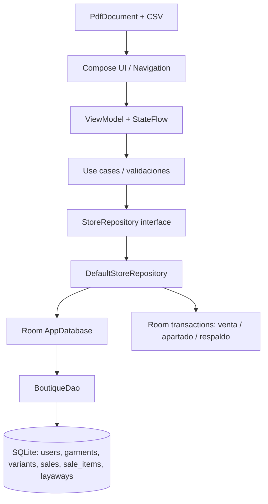

# 02 · Arquitectura

## Paquetes

- `ui`: Compose, tema, navegación y estado de presentación.
- `domain`: modelos, contrato de repositorio y casos de uso.
- `data`: entidades Room, DAO e implementación del repositorio.
- `di`: configuración Hilt de Room/repositorio.
- `report`: creación y compartición de PDF/CSV.
- `util`: formato dominicano de dinero y fecha.

Las ventas actualizan stock e insertan cabecera y detalle dentro de una transacción. Los apartados descuentan stock en el momento de reservarlo; la cancelación repone la cantidad.
