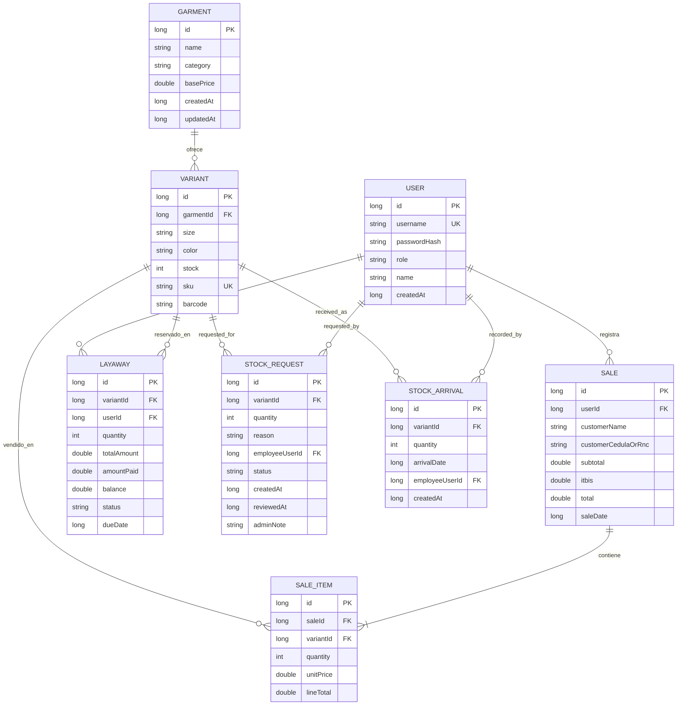

# 03 · Modelo de datos

Las FK de prendas eliminan sus variantes en cascada. El detalle de ventas se elimina junto con la venta; ventas y apartados protegen la referencia a las variantes y usuarios.
